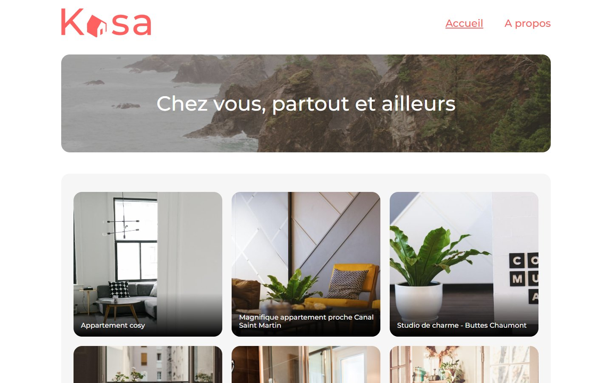
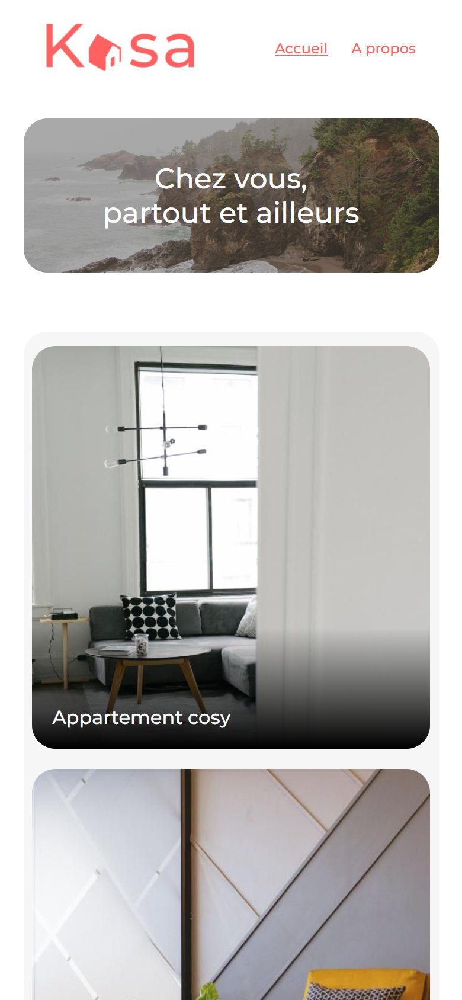

# Kasa

A React single-page application for an apartment rental platform, built from a desktop and mobile mockup.

**Live site:** https://idento.github.io/Kasa/

| Desktop | Mobile |
| --- | --- |
|  |  |

## What was done

- **Home page**: banner and a grid of rental cards generated from JSON data.
- **Rental page** (`/logement/:id`): photo carousel (previous and next arrows, counter), title, location, tags, host, star rating, and collapsible description and equipment sections.
- **About page**: collapsible sections for the company values.
- **404 page** for unknown addresses and unknown rental ids.
- Reusable React components (card, carousel, collapsible section, rating, tag), styles in Sass, responsive from desktop to mobile.

Changes made in 2026 to publish it on GitHub Pages:

- the router uses hash URLs (`/Kasa/#/about`), so reloading a page or opening a shared link works on static hosting;
- two components read the current address from `react-router` instead of `window.location`, which gave wrong results once the site lived in a sub-folder.
- all photos (rentals and hosts) are now CC0 images from StockSnap, stored in the repository; see [PHOTO-CREDITS.md](PHOTO-CREDITS.md).
- lighter home page: 600 px thumbnails for the rental cards, loaded only when they come into view, and the two banners converted from PNG to JPEG (3.3 MB down to 0.3 MB);
- accessibility: each card link has a name, card titles follow the heading order, and the pages sit inside a `main` landmark.

## Lighthouse

Measured on the live site on October 21, 2026 (Lighthouse 13.5, median of 3 runs):

| | Performance | Accessibility | Best practices | SEO |
| --- | --- | --- | --- | --- |
| Mobile | 84 | 94 | 100 | 100 |
| Desktop | 98 | 94 | 100 | 100 |

## Stack

React 18, React Router 6, Sass, Create React App. Deployed on GitHub Pages with GitHub Actions.

## Run locally

```sh
npm install
npm start
```
